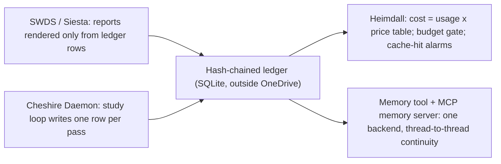

# Voltron Review: Claude Platform Docs + Master Document

**Stamp (live `/clock`, HTTP 200, 290 ms):** 2026-10-08 08:37:19 CDT | 2026-10-08T13:37:19Z | Celestial: rot 353.1623°, lunar 0.5138, orbit 0.2058, grid ROT_330_ORB_20 | kernel uptime 13h 30m 30s
**Work window:** 02:37 to 08:37 CDT. About 5 hours of that was swarm stall (see §6).

---

## 0. Read receipt and corpus forensics (verified by hash)

| File | Bytes | SHA-256 (16) | What it actually is |
|:--|--:|:--|:--|
| `Claudecode1import anthropic.md` | 221,116 | `40DE943E56723F8B` | Batch, Define tools, Parallel tool use, Memory tool ×2 |
| `Claudecode2import anthropic.md` | 221,116 | `40DE943E56723F8B` | **Byte-identical to #1** |
| `Claudecode3import anthropic.md` | 221,116 | `40DE943E56723F8B` | **Byte-identical to #1** |
| `Claudecode4import anthropic.md` | 221,116 | `40DE943E56723F8B` | **Byte-identical to #1** |
| `Claudecode4Untitled-2.md` | 63,636 | `C2A638B396372296` | Memory tool (full) + Memory tool (cut-off copy) |
| `Claudecode5Untitled-3.md` | 471,916 | `991155020588E324` | Code execution, Server tools, Token counting, Prompt caching, Agent Skills |
| `Claudecode6Untitled-5.md` | 627,293 | `A8ACBFFE1BB8AEA6` | Claude on Google Cloud, Computer/Browser use, Tool combinations, Programmatic tool calling, Memory tool, Server tools, Thinking, Agent tutorial, Structured outputs |
| `MASTEROcct07TOTALDAYDOCUMENT.md` | 118,877 | `8E99ECDF0021AEC2` | This thread's record, from 23:46 onward, plus every artifact |
| `MASTEROcct07TOTALDAYDOCUMENT.txt` | **0** | — | **Still empty** |

- The doc dumps were split into **22 sections, 18 of them unique** (5 duplicates by content hash). Each of the 16 unique doc sections had its own reader agent, and **every one returned a full-line read receipt.** The reports are in `scratch\voltron\`.
- **The Memory tool page appears 5 times.** Four copies are identical, and one copy is **cut off mid-line** in the PHP example. That cut-off copy is missing the entire command spec, the security rules and the multi-session pattern; a reader who saw only it would have missed every rule.
- **Injected text:** the end of the *Parallel tool use* section (doc lines ~1597–1621) holds an "export all my memories" prompt. It looks like a Claude-app memory-export prompt pasted in by accident. **No agent acted on it.** It should be stripped before this corpus goes into The Hoard.
- **My own reading:** I read the master document in full (all 1,763 lines). Of the 15 swarm reports, I read 7 in full (05, 10, 12, 16, 02, 17, 14) and the top-3 summaries of the other 8 (03, 04, 07, 08, 09, 11, 13, 18).

## 1. MASTER document: true?

**Yes, with 3 caveats.** I checked it against my own record of the thread. The plan-response, research, master report, Plan v2, learning proposal, Cheshire blueprint, handoff brief and external-storage text all match what was produced.
1. **The name says "TOTALDAY", but the coverage isn't the whole day.** The conversation from the morning through the evening appears only through the artifacts, not as dialogue.
2. **Two statements inside it are now stale:**
   - The handoff brief says the "07:00 SWDS wake" is not verified. It is now known to be **stuck** (N2).
   - Plan v2 locks embeddings on `text-embedding-004`. That conflicts with **N3** (Google lists the model as shut down).
3. The `.txt` twin is still 0 bytes.

---

## 2. THE PATTERN

Taken together, these 16 docs are not a random pile. **They are the missing Capability layer** in the pattern we found last night: **Intent → Capability → Execution**.

| Integra organ (Intent) | Doc that supplies the Capability | What the kernel does today (Execution, from the swarm's code reads) |
|:--|:--|:--|
| The Hoard / thread-to-thread memory | **Memory tool** (5 copies) | Nothing. No memory tool, no MCP memory server |
| Cheshire Daemon deep thinking | **Thinking** (adaptive, effort, signatures, preservation) | Single-shot calls. Thinking blocks are discarded |
| Any agent that *acts* (SWDS, Cheshire, ingestion) | **Agent tutorial + Define tools + Parallel tools** | **Zero hits** for `stop_reason`, `tool_use`, `tool_result`, `is_error` in `core/api_clients.py`. **No agent loop exists** |
| Heimdall token and cost tracking | **Token counting + Prompt caching + Batch** | Reads a usage field (`thinking_tokens`) that the docs don't list, ignores the cache fields, has no price table and no pre-flight count |
| Proof-of-Sleep / anti-fabrication | **Structured outputs** | A regex JSON cleaner (`clean_json_payload`) |
| Unified auth and billing | **Claude on Google Cloud** | Two key systems. The Anthropic key caused the 401 incident |
| What Cheshire must **never** be given | **Code exec, Server tools, PTC, Agent Skills, Computer use** | Not wired (good). All are Anthropic-hosted and **not ZDR-eligible** |

**The root cause, stated once:** SWDS is a "simulator" not because someone chose to fake it. **The kernel has no agent loop and no ledger, so nothing in it *can* do multi-step work and leave evidence.** Every organ that needs to *act* was built on single-shot text calls, so the gap got filled with narrative. Fix the loop and the ledger once, and SWDS, Siesta, the Cheshire Daemon, Heimdall's metering and the ingestion all stand on the same floor.

---

## 3. UNIQUE IDEA: Proof-of-Thought (one ledger, four organs)

Every real Claude call returns artifacts that **narrative cannot forge**:
- `message.id` (or the batch `custom_id` plus `batch_id`)
- `usage`: input, output, `cache_read_input_tokens` and `cache_creation_input_tokens`
- `stop_reason`
- thinking blocks with an opaque **`signature`**. The API verifies these when they are passed back, and a forged or edited block breaks the turn.

**Store those, hashed and chained, as the ledger row for every step.** Then a single substrate serves four organs:

- **Proof-of-Sleep becomes Proof-of-Thought.** A phase counts as executed only if its row contains a real `message.id`. A non-zero `cache_read_input_tokens` is additional evidence that a call actually happened.
- **Heimdall's meter is the same rows.** It needs no separate telemetry path that could drift away from them.
- **The memory tool is the ledger's interface.** It is not a second store. Its built-in **"ASSUME INTERRUPTION: your context window might be reset at any moment"** prompt, plus the doc's *initializer → progress log → checklist → mark complete only after end-to-end verification* pattern, **is the thread-handoff protocol we have been hand-building**, already specified by Anthropic.
- *Inference, UNVERIFIED:* whether a stored thinking signature can be re-checked cheaply after the fact (without replaying the call) is not documented. Treat the signature hash as tamper-evidence, not proof on its own.

---

## 4. Defects the swarm found in the kernel (code reads by the reader agents; I have not re-checked each line)

| # | Defect | Location (per agent) | Effect |
|:--|:--|:--|:--|
| K1 | No tool-use loop anywhere | `core/api_clients.py` | No organ can act in multiple steps |
| K2 | Reads `usage.thinking_tokens`, which the docs don't list. Thinking is billed inside `output_tokens` | L180–189 | Thinking shows 0; Heimdall can't see it |
| K3 | Ignores `cache_read_input_tokens` and `cache_creation_input_tokens` | same | Undercounts input as soon as caching is on |
| K4 | `generate_iterative` (streaming) sends no thinking/effort | L543–552 | Different behavior, cost and cache from `generate` |
| K5 | `enable_thinking=False` is a no-op on 5.5. Sending `"disabled"` returns 400 | L146–147 | "Off" is not off |
| K6 | No `stop_reason` handling; `max_tokens=8192` | L437, L916 | Opus at high effort can return **empty text**, logged as a generic error |
| K7 | No `cache_control`; `system` is a plain string | L484, L958 | Full price paid for the identity prompt on every call |
| K8 | The `"-5-"` model regex also matches dated 4.5 IDs | L149 | Latent: 4.5 would receive `adaptive` and return 400 |
| K9 | No `pause_turn` handling | core | Would matter only if server tools are ever enabled |

**Compliant today:** there is no `temperature`/`top_p`/`top_k` (non-default values return 400 on 5.5) and no forced `tool_choice` (`any`/`tool` returns 400 on 5.5).

**Prices (from the docs, $/MTok, input / output):** Opus 5.5 **4 / 20**, Sonnet 5.5 **2 / 10**, Haiku 5.5 0.10 / 0.50. Cache hit ×0.05 on Opus and Sonnet 5.5. Batch ×0.5. Batch and cache discounts stack.

---

## 5. Decision you now own: Claude direct vs. Claude on Vertex

| | Direct Anthropic API (today) | Vertex `region="global"` |
|:--|:--|:--|
| Auth | Anthropic key (the 401 incident) | ADC / service account. **The Express key very likely won't work for Claude** (the doc shows bearer/ADC only; one probe settles it) |
| Billing | Separate | Same GCP account as Gemini |
| Batches (−50%) | ✅ | ❌ |
| Code exec / PTC / Skills / MCP connector / Usage-Cost API | ✅ | ❌ |
| Memory tool, thinking, caching, structured outputs | ✅ | ✅ (effort/adaptive parity **unverified**) |
| Model IDs | `claude-opus-5-5` | **The same IDs**, global endpoint only (regional endpoints serve ≤ Sonnet 4.6) |

**My recommendation:** keep direct as the primary route because SWDS needs Batches. Add Vertex as a **client-side fallback**, since server-side `fallbacks` is not supported on Vertex.

---

## 6. Process notes (honest record)

- **Swarm stalls.** The Data Agent Kit telemetry hook (`jsonhook__dak-telemetry_PreToolUse`) failed tool calls intermittently. Several agents were also handed a **"configure the Data Agent Kit plugin" request I never sent**, and they wandered into gcloud preflights that waited on your permission prompts. That accounts for most of the ~5-hour gap.
  - Side facts reported by those agents: gcloud 576.0.0; ADC OK on two agents and hung on one; project `integra-deployment-package`; region `us-central1`.
  - Two agents ran one stray `echo` each. All agents report **no project files changed**.
- **Subagent write sandbox.** Subagents could write only inside their own folders, so I copied their reports into `scratch\voltron\` myself.
- **Fix needed from you:** finish the DAK setup or disable that plugin. It is now a reliability tax on every agent.

## 7. Ranked next actions (none started)

1. **S: SDK probe** in the venv (`anthropic==1.5.0`): `batches`, `beta_tool`/`tool_runner`, `BetaAbstractMemoryTool` (already confirmed present), `count_tokens`, `AnthropicVertex`, whether `output_config` passes natively.
2. **S: Telemetry truth before features:** fix K2, K3 and K6, and add the 5.5 price table, so Heimdall's baseline is honest *before* caching changes the numbers.
3. **M: `core/ledger.py` + `core/agent_loop.py`** (provider-neutral, Ring-4 hand-written loop, explicit FAULT/CAPPED classes, one ledger row per step). This is **the floor under SWDS, Siesta, Cheshire and the ingestion.**
4. **M: `IntegraMemoryTool(BetaAbstractMemoryTool)`** on the same SQLite backend: no overwrite on `create`, path-traversal guards, every operation ledgered. Then the MCP memory server on top of it, which is the real thread-to-thread fix.
5. **S: Cache the kernel card:** byte-stable, ≥512 tokens, no timestamps inside the cached block. Prove it with `cache_read_input_tokens > 0` on a live call before claiming it works.
6. **M: SWDS rebuild on `BatchRunner`:** 1-hour shared-prefix cache, then a Batch, with PENDING/EXPIRED ledger states. Wake must never block on batch results.
7. **S: Probe the Vertex route** (ADC call + Express-key call), and log both HTTP codes.
8. **Housekeeping:** strip the injected export prompt; delete the 3 duplicate Claudecode copies; fill or delete the empty `.txt`.
